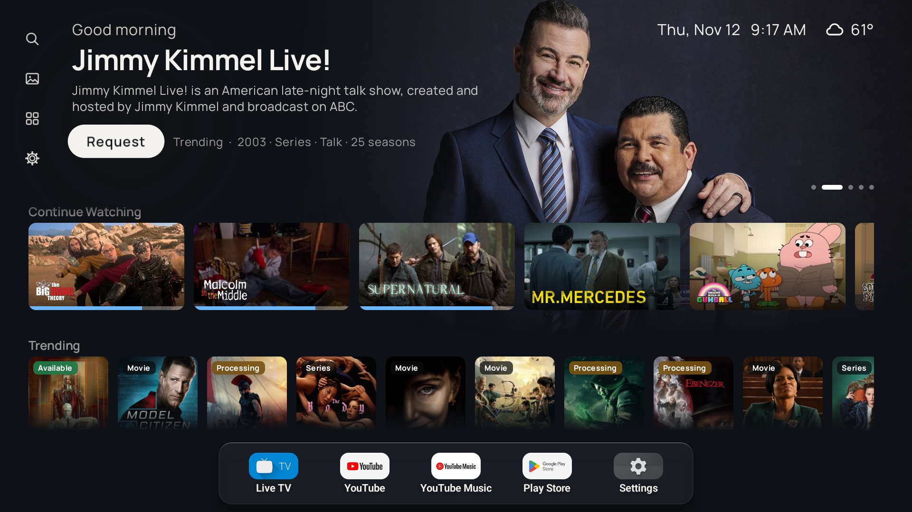

# Lobby for Android TV

A native Android TV launcher for [Lobby](https://github.com/CtznSniiips/Lobby): Continue Watching, Next Up, Live TV,
sports and Seerr discovery/requests on the home screen, backed by the Lobby plugin for Jellyfin or Emby.

This is the Android TV sibling of the Samsung/Tizen app. The plugins are shared and **need no changes**: this app is
just another caller of the same `/Lobby/*` routes with the same `Authorization: Lobby <token>` header, and the same
pairing flow (enter the server address, get a code, approve it in the plugin's admin page).

Android TV only. Not intended for phones or tablets.

<picture>
  
</picture>

## Lobby: Emby/Jellyfin and Seerr on Home

Lobby adds rows from your own Emby or Jellyfin server and Seerr to Home: Continue Watching, On Now, games for teams you follow, and Seerr's Trending and Popular lists. OK resumes or plays in the Emby/Jellyfin app, or requests a title in Seerr as the right person. The Watch layout puts a rotating featured title at the top (including your teams' games when they're about to start), with one row per band below and your apps in a dock along the bottom.

Lobby ships a plugin for each server, built from the same design and talking the same TV-facing API:

1. Install whichever plugin matches your server — [`emby-plugin/`](emby-plugin/README.md) for Emby, [`jellyfin-plugin/`](jellyfin-plugin/README.md) for Jellyfin — and set up Seerr and account links on its page.
2. On the TV: Settings → Emby & Seerr → Connect, enter the server address and approve the code on the plugin page.
3. Choose rows, order, teams and playback timing in Settings → Emby & Seerr. Those settings belong to the TV and are kept on the server.

## How playback works

Lobby never plays media itself. Pressing a title calls `POST /Lobby/Play`; the plugin finds the official Jellyfin or
Emby Android TV app's session by `DeviceId` and sends it a play command, then Lobby opens that app. Install the
official app on the same device alongside Lobby.

## What replaces the Tizen-only features

| Tizen (`device.js`)             | Android TV                                                                  |
| ------------------------------- | --------------------------------------------------------------------------- |
| Installed-app dock              | `PackageManager` query for `LEANBACK_LAUNCHER` activities (`TvDevice.dockApps`) |
| Samsung Home/Settings shortcuts | `Settings.ACTION_SETTINGS`                                                  |
| DUID for pairing                | Android ID sent as `Duid`; admin can assign the app's real `DeviceId`       |
| Art Mode + Screen saver         | The system screen saver: Screen saver button on Home, optional idle start   |
| HDMI input switching            | TV Input Framework: HDMI inputs row on Home                                  |

## Setting Lobby as your home screen

To make Lobby the launcher that opens when you press the Home button:

1. Make Lobby your home app — from Lobby's **System** settings, or Android's **Settings → Apps → Special app access → Home app** (wording varies by device).
2. Turn on Lobby's **Home-button override**. It's an accessibility service that returns you to Lobby when the Home button would otherwise open the stock launcher; on Google TV the Home-app role alone often isn't enough, so this is what makes the physical Home button come back to Lobby.

### The restricted-settings wall

Step 2 is the hard part on modern Google TV. From Android 12 on, apps installed from outside the Play Store are marked **restricted**: their accessibility services can't be turned on through the normal toggle. How far the lock-down goes varies by device — on the strictest boxes the system **reverts** the `enabled_accessibility_services` setting even when you write it directly over ADB, so there is no way to turn the override on from the TV itself.

Because an app can't lift its own restriction (that needs shell privileges the app can't hold), the dependable route is to install Lobby from a source Android already trusts.

**Install over ADB (the reliable route).** An app installed with `adb install` counts as trusted, so it isn't flagged as restricted and the accessibility toggle works normally:

1. Connect ADB to the TV (see [Connecting ADB](#connecting-adb)).
2. `adb install -r Lobby-<version>.apk` — the `-r` keeps your data.
3. Settings → Accessibility → turn on **Lobby Home button**.

### Keeping the override across updates

Updating Lobby from a source Android doesn't trust re-applies the restriction and switches the override back off. **Lobby's updater avoids this by installing over ADB** — a trusted install, the same as `adb install` — so the override (and Lobby's trusted status) carries across updates instead of re-locking, and you never need a PC after the one-time setup.

Set it up once, entirely on the TV. Which wireless-ADB method your TV has isn't the same everywhere, so Lobby's **Settings → System → Self-update over ADB** leads with the one your TV most likely uses and keeps the other one tap away ("My TV has no pairing option" / "My TV has Wireless Debugging (pairing)"):

1. Turn on Lobby's accessibility service (Settings → Accessibility → **Lobby Home button**) so the override is on. Installing over `adb install` first, as above, is what lets you turn it on. (On the NVIDIA Shield, accessibility lives under **Device settings → Accessibility**.)
2. Turn on wireless ADB under Developer options (Settings → System → Developer options) and connect in **Self-update over ADB**:
   - **Android 11+ — Wireless debugging (pairing).** Tap **Pair automatically**, then open the TV's **Pair device with pairing code** dialog and leave it on screen. Lobby reads the 6-digit code off the dialog (that's the accessibility service's other job) and pairs itself — no typing, no second device.
   - **Older Android TV and the NVIDIA Shield — Network debugging (port 5555, no pairing).** Turn on **Network debugging**, tap **Connect via Network debugging**, accept the **Allow debugging** prompt when it appears, then tap Connect once more.

After that, Lobby connects just once (it reconnects on its own) and installs its own updates over ADB from the couch. The update check, notice and release are unchanged; only the install path moved to ADB — the **Download & self-install latest** button does the install.

### Connecting ADB

The commands above run over an existing ADB connection — the TV's address goes in the `adb connect`/`adb pair` step, not in the commands themselves. A TV box usually has no USB port, so connect over the network:

1. On the TV, turn on **Developer options** (Settings → System → About, then click the build number several times), then enable **Network debugging** (older Android TV, and the NVIDIA Shield even on Android 11) or **Wireless debugging** (Android 11+) under Developer options.
2. From a computer with [platform-tools](https://developer.android.com/tools/releases/platform-tools), connect to the TV's IP (shown under Settings → Network, and on the Wireless debugging screen):
   - Older Android TV: `adb connect <tv-ip>:5555`
   - Android 11+ Wireless debugging (6-digit pairing code, randomized ports — not 5555): `adb pair <tv-ip>:<pair-port>`, enter the code, then `adb connect <tv-ip>:<connect-port>`.
3. Accept the "Allow debugging?" prompt on the TV the first time. If ADB later reports `more than one device/emulator`, another device is attached — target the TV by adding `-s <tv-ip>:5555` before `shell`/`install` (`adb devices` lists what's attached).

## Build

Open in Android Studio, or `./gradlew assembleDebug` with the Android SDK installed. CI builds a debug APK on every push.
Side-load with `adb install app-debug.apk`. To use it as the home screen, choose Lobby when the TV asks for a home app
(it declares the `HOME` category).
